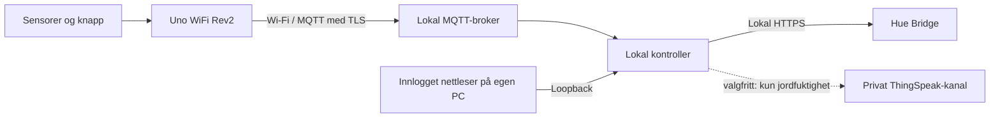

# Wi-Fi, MQTT og privat webapp

Dette er det nye nettverksalternativet. Den tidligere USB-styringen beholdes
som alternativ for feilsøking. Ikke start begge kontrollerne mot samme Hue-lys.



## Prøv webappen uten hjemmeutstyret

Fra prosjektmappen, med Python 3.10 eller nyere:

```sh
python -m pip install -r requirements.txt
python tools/setup_web.py
python webapp.py --demo
```

Åpne nettleseren lokalt på maskinen som kjører programmet, port 8765 på
loopback-adressen 127.0.0.1. Logg inn med passordet du nettopp valgte.
Demo viser simulerte, tørre jorddata. Du kan velge hvitt, gult, kino, av eller
automatisk og simulere vanning. Ingen av disse demoknappene kontakter Hue.
Oppdater siden for ny status; det brukes ingen tredjepartsscripts eller CDN-er.

Manuelle lysvalg gjelder i 15 minutter og kan overstyre tidsplanen. Automatisk
modus starter en ny forsiktig 30-minutters ventetid innenfor 07–11. I ekte modus
kreves ferske sensordata; lerret nede vinner alltid over en manuell lyskommando.
Når det heves er manuell modus kansellert, slik at de tidligere kinoreglene gjelder.

Webknappen simulerer vanning på **serveren** i fem sekunder. Den endrer ikke
jordmålingen eller Arduino-LED-en. Den fysiske Arduino-knappen simulerer på
kortet og tenner LED-en. Begge er eksplisitt simulering; ingen pumpe trengs.

## Sett opp den lokale MQTT-brokeren

Installer Mosquitto 2.x på PC-en eller en egen lokal server. Ingen offentlig
skyboker er nødvendig. Bruk konfigurasjons- og ACL-eksemplene i `mqtt/`.

1. Skaff/lag et server-sertifikat med riktig DNS-navn/IP i SAN, og tilhørende CA.
   Oppbevar privatnøkkel og passordfiler under `mqtt/private/` eller utenfor Git.
   Sett et fast lokalt DNS-navn/adressereservasjon for broker.
2. Opprett to ulike brukere med `mosquitto_passwd` (kommandoene spør om passord):

   ```sh
   mosquitto_passwd -c mqtt/private/passwords sensor-rom101
   mosquitto_passwd mqtt/private/passwords controller-rom101
   ```

   Opprett mappen først. `-c` brukes bare første gang; det overskriver passordfilen.
3. Kopier `mqtt/acl.example` til den beskyttede konfigurasjonsmappen. Kopier
   `mqtt/mosquitto.conf.example`, erstatt IP og alle filstier, og sett begrensede
   filrettigheter slik at brokerbrukeren kan lese dem.
4. Start Mosquitto med den lokale konfigurasjonen. Tillat port 8883 bare fra
   nødvendige lokale enheter i brannmuren. Anonyme klienter og port 1883 skal
   ikke være aktivert. Ingen portvideresending i ruteren.
5. Verifiser at brokerens sertifikat stoles på av både PC og NINA-kortet. Se
   [SECURITY.md](SECURITY.md); lokal CA på NINA må verifiseres med faktisk maskinvare.

## Bygg Wi-Fi-sensornoden

Koblingene er de samme som i README. Installer biblioteker og bygg:

```sh
arduino-cli core install arduino:megaavr@1.8.8
arduino-cli lib install "WiFiNINA@1.9.1" "PubSubClient@2.8"
python tools/build_arduino.py --sketch wifi_sensor
```

Kopier `firmware/wifi_sensor/arduino_secrets.example.h` til `arduino_secrets.h`
i samme mappe og fyll inn nettverk, brokerens DNS-navn og **sensorens** passord.
Sett unikt klient-ID og tema per rom. Plassholdere kan bygges, men kan ikke koble til.

For Arduino IDE: legg `wifi_sensor.ino`, `network.h`, det lokale hemmelighetshodet,
`arduino_secrets.example.h`, og rotfilene `sensor_node.h`/`sensor_config.h` sammen
i en mappe kalt `wifi_sensor`. Velg Uno WiFi Rev2 og last opp. Konfigurer kortets
sertifikatlager før nettverkstesten. Wi-Fi gjenoppkobles med ti sekunders mellomrom;
bibliotekkall kan blokkere kort under nettverksfeil, så mål fysisk responstid.

Bevegelse og lerret samles hvert 100 ms og publiseres ved endring, ellers hvert
sekund. MQTT-publisering bruker QoS 0 uten retain; korte hendelser kan gå tapt
ved forbindelsesbrudd. Nye rom får egne temaer og brukere. Dette er lokal
kontroll med nettverksavhengighet, ikke et sanntids- eller sikkerhetssystem.

## Start med ditt faktiske utstyr

Opprett webpassord som over. Sett Hue- og MQTT-verdier lokalt, eksempel i PowerShell:

```powershell
$env:HUE_BRIDGE_HOST = "YOUR_BRIDGE_HOSTNAME"
$env:HUE_USERNAME = "YOUR_HUE_USERNAME"
$env:HUE_LIGHT_IDS = "4,5,6"
$env:HUE_CA_FILE = "C:\private\hue-ca.pem"
$env:MQTT_HOST = "YOUR_MQTT_DNS_HOSTNAME"
$env:MQTT_PORT = "8883"
$env:MQTT_ROOM = "rom101"
$env:MQTT_USERNAME = "controller-rom101"
$env:MQTT_PASSWORD = "YOUR_UNIQUE_CONTROLLER_PASSWORD"
$env:MQTT_CA_FILE = "C:\private\mqtt-ca.pem"
python webapp.py
```

HUE_CA_FILE er bare nødvendig hvis CA-en ikke allerede stoles på av systemet.
Miljøvariablene er eksempler, ikke ekte verdier. For lokale hemmeligheter unngå
delt terminalhistorikk; bruk privat miljøkonfigurasjon eller en lokal secret manager.
Webkontoen er et eget passord, ikke Hue- eller MQTT-passordet.
Tidsreglene i nettverkskontrolleren er fast Europe/Oslo og av/kino utenfor 07–11.
Den tidligere `control_hue.py` er USB-alternativet og skal ikke kjøres samtidig.

## Valgfri sky og framtidige forbindelser

`python webapp.py --cloud` aktiverer eksport hvert minutt til en **egen privat**
ThingSpeak-kanal når `THINGSPEAK_WRITE_API_KEY` er satt lokalt. Field1 er
jordfuktighetsanslag og field2 er vanningsbehov. Ingen innkommende skystyring,
bevegelsesdata eller Hue-hemmeligheter sendes. Ved internettfeil fortsetter
lokal lysstyring. Ikke bruk den gamle temperaturkanalen uten å endre feltnavn.

Wi-Fi er valgt for rom med strøm og dekning; MQTT skiller noder, kontroller og
visning. LoRa/LoRaWAN kan senere gi egne batterinoder for fjerntliggende potter
via en gateway som oversetter til MQTT. BLE kan brukes til lokal provisjonering
på egnede kort. Disse to tilleggene er **ikke implementert**; de krever egne
utstyr-/energi-/sikkerhetsvurderinger. Selve lysstyringen flyttes ikke til skyen.

## Verifikasjon

```sh
python -m unittest discover -s tests -v
python tools/test_web_http.py
# Ekstra lokal MQTT-integrasjonstest, krever Docker, OpenSSL og Linux/macOS:
python tools/test_mqtt_tls.py
```

HTTP-testen bruker ekte lokal server og midlertidige testpassord. MQTT-testen
starter en isolert Mosquitto med TLS og ACL, tester tillatt trafikk samt avvisning
av anonym bruker, feil passord og skriving til feil rom, og fjerner testcontaineren.
Den konfigurerer ikke hjemmenettet ditt. Fysisk Wi-Fi, sertifikatlager, sensorer
og ekte Hue må fremdeles prøves med ditt utstyr.
