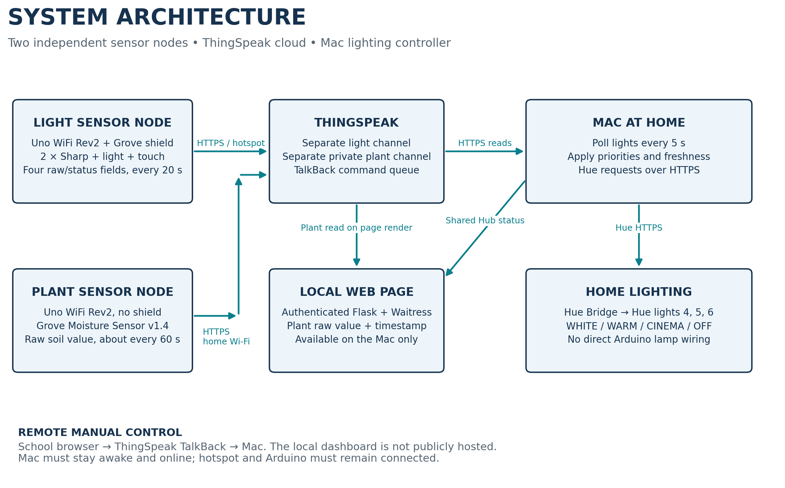
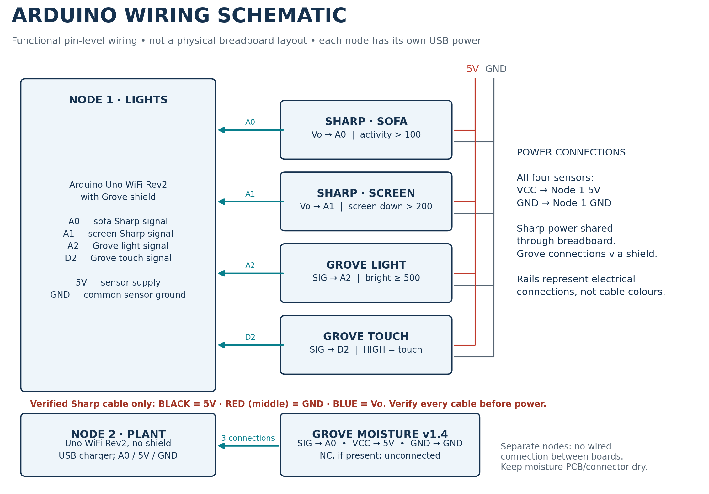

# IoT report and group briefing

English documentation for the demonstrated two-Arduino ThingSpeak/Hue prototype.

## Download

- **[Complete package (ZIP)](IoT_Report_Package.zip)** — all report, guide and diagram files.
- [Editable report (Word)](IoT_Project_Report_Draft.docx) · [Report PDF](IoT_Project_Report_Draft.pdf)
- [Group need-to-know (Word)](Group_Need_to_Know.docx) · [Group guide PDF](Group_Need_to_Know.pdf)
- [Submission checklist and evidence](Submission_Checklist_and_Evidence.md)

On a file page, use **Download raw file** to save the original file. The report and guide are in English.

## Diagrams

Editable SVG and printable PDF versions are included alongside the PNG images.

## Before submission

This is an editable draft based on supplied code, terminal output and user-confirmed physical tests. Add names, contributions, photos and quantitative measurements. Unverified tests are marked explicitly; the package does not include the complete final source code or credentials. The documentation describes local changes demonstrated after commit 45a67b5; those runtime changes are not introduced by this documentation branch.
